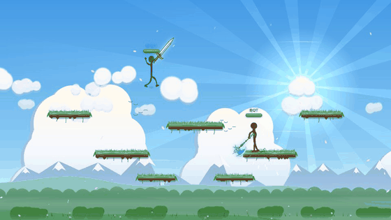

# Team notes

For plzgimmeaname, and for your Claude if you use one. Written by Aarush's Claude at Aarush's request (Nov 1, 2026), so the two of you don't work on the same things. Aarush's and your own instructions outrank this file. If you use Claude, point it here from your session or your CLAUDE.md.

## The art direction was never written down

This is on us: it only existed in Aarush's private notes, so you couldn't have known it.

- **Target look:** shonen anime. Saturated, energetic colour; held poses, impact frames, speed lines, cut-ins, move-name cards.
- **Lighting:** consistent, from the upper left, shaped with value ramps.
- **Fighters are locked:** near-black body, neon outline, round head. Store art and trailers match this, so ask before changing it.
- **Full-screen white flashes are rationed:** keep them for kills and finishers.

## Pixel Effects: please talk to Aarush before building more

Aarush's first reaction is that the pixel look feels far from the game's theme. Nothing has been decided about what happens to it, and nothing has been reverted.

The main clash is resolution: 2px unsmoothed art sits on top of smooth HD arenas and thin vector fighters, and the boss and domain visuals remastered in October now go through the pixel pass too.

The event hooks are useful whatever the style ends up being. They cover swings, hits, supers, domains and finishers, with a settings toggle and fallbacks to the old effects.

We also recorded two 12-second AI vs AI matches, one with the setting on and one with it off. They aren't the same fight, so this is a rough comparison. With it off, both fighters stay readable in the key frames we checked. With it on, the red fighter is often buried under white pixels or a gold pillar during supers and heavy exchanges, and 22-27 of the 28 allowed effects are live at peak for most of the clip. Readability may matter more than the style question.

One thing to check: after the first frame, `_passInstall` routes every `ctx` call through a wrapper, even with the setting off. That needs testing on low-end school machines.

## Basic rules for everyone

These apply to all of us, including Aarush and any Claude. `CLAUDE.md` has the full list.

**Before you push**
1. **Test it in the running game.** Start it (`python3 -m http.server 8080` or `node server.js`), play the thing you changed, and check the console for errors. A syntax pass doesn't count as tested.
2. **Look at it.** For anything visual, check real gameplay in a screenshot or clip, in a busy fight as well as a quiet one. Can you still see both fighters?
3. **Test what you could have affected.** If you changed shared code, also try a boss fight and a story chapter. If it's behind a setting, test both on and off.
4. **Run `npm run check`.**
5. **Bump `?v=` for every file you changed** with `node tools/dev/bump-version.js <files>`. Otherwise browsers and the school zip run old code.
6. **Pull first, and never force-push `main`.** Students and players get builds from this code, so `main` should always run.
7. **Say what you didn't test** in the commit message. That's far better than someone finding out later.

**In the code**
- Patch, don't replace. Don't remove or rewrite large systems without asking.
- Globals only: no `import` or `export`. A single `import` line silences every file loaded after it.
- A new file needs a `<script>` tag in `index.html`, after everything it depends on.
- All damage goes through `dealDamage()`. Never write `target.health -=`.
- Never trigger a cinematic inside `dealDamage()`. Set a flag and trigger it at frame start in `gameLoop`.
- Guard your references: `if (!boss || boss.health <= 0) return;`.
- `activeCinematic`, `isCinematic` and `slowMotion` depend on each other. Changing one without the others freezes the game.

**In the design**
- The game must be hard, with no infinite combos.
- QTEs fire only at cinematic HP checkpoints, never during active combat.
- AI must never idle, fall off the map or get stuck in a state with no way out.
- Keep secret-boss spoilers out of ungated changelog lines.

## Who is on what

**Off limits: please don't change these without asking Aarush first.** Aarush is actively working on all of them:
- Making Story Mode beatable at every difficulty (`js/story/`, `tools/level-tester.js`)
- God and Absolute Axiom fights, plus checkpoint QTEs (`js/smb-god.js`, `js/smb-absolute-axiom.js`, `js/smb-axiom-multiverse.js`, `js/smb-qte-*.js`)
- Rebuilding the Fight Ladder as a skills curriculum (`js/smb-ladder.js`)
- Finishing the story cinematics
- Sovereign, both the fighter and the brain (`js/smb-smk2-*.js`, `js/smb-sov-*.js`, `js/smb-brain*.js`, `js/smb-adaptive-ai.js`, `tools/brain/`)

That includes all of Story Mode, not only the fixes above: chapters, levels, scenes and narration. Most of these files also have large uncommitted changes right now, so edits there are likely to conflict. If something in these areas looks broken, tell Aarush instead of patching it.

**Shared, so keep changes small:** `js/smb-combat.js`, `js/smb-fighter.js`, `js/smb-loop-core.js`, `js/smb-menu-startcore.js`, `index.html`.

**Your lane (suggested by Claude, not agreed yet):** combat feel, meaning how swings, hits and supers look and read, plus fighter animation. Your keybinds, Combo Domain and limb animation work already shipped in 4.7.3. Tell Aarush if you'd rather take something else.

**plzgimmeaname (Nov 2, 2026, written by their Claude):** taking the combat-feel lane. Done in 4.9.125, nothing new built in the pixel style:
- **Pixel Effects is off by default.** Players who had it on keep their choice. The `ctx` redirect is now only installed while the setting is on and is removed when it's turned off, so with it off every `ctx` call goes straight to the prototype (checked: 0 own properties on `ctx` after a 12 s match).
- **The pixel pass no longer touches the October boss, TrueForm, domain or cinematic visuals.** It covers only class effects, curse auras, Spartan rage, map perks and projectiles.
- **Readability:** the live-effect cap is down from 28 to 14 (that was the peak in the recorded test). The gold pillar on supers is gone, and the domain-open pillar and burst are smaller. Pixel effects can't flash the screen any more, except on a finisher's killing blow.
- **Prototype for review: "Anime Supers (prototype)"** in Settings → Graphics, off by default (`js/smb-anime-super.js`). A super gets a 3-frame impact frame in the fighter's colour (not white), a darkened background, radial speed lines and the move's name card, built only from the existing `CinFX` kit. If Aarush likes the direction, the same treatment can go on Q abilities, domain opens and finishers, replacing the pixel look while keeping its hooks.

  

  *Headless capture with `tools/showcase/session.js`: 15 fps, scaled down to 560 px, 128 colours, so it looks softer than the game. Supers were topped up every 1.5 s so they land inside the clip.*
- **Tested:** headless 12 s AI vs AI matches with effects off, pixel on, and anime on, using `tools/showcase/session.js`, plus contact sheets. No page errors, both fighters readable. `npm run build` and `npm run audit` pass, and lint is clean on the changed files.
- **Not tested:** a live keyboard play, low-end school machines, a boss fight or story chapter with the setting on, and online play. `npm run lint` already fails across the repo (about 150 errors, mostly in `tools/`), none from these changes.

**Aarush's answer (Nov 2, 2026, written by Aarush's Claude):** Anime Supers looks good. Go ahead and try the next steps:
- **Q abilities:** worth a try, but expect it to be tricky, because not every ability is an actual move. Some may not suit a name card or an impact frame.
- **Domain opens:** you're welcome to do these.
- **Finishers and convictions:** these already have something similar, so check what's there before adding to them.

**plzgimmeaname (Nov 3, 2026, written by their Claude):** the next steps are done. The setting is renamed "Anime Moves (prototype)", still off by default, and the code is in `js/smb-anime-super.js`.
- **Q abilities:** every Q shows a short name card with the ability's `abilityName` (0.8 s, shorter than a super's). The impact frame and speed lines wait for the ability's first hit, within 1.5 s. Abilities that are buffs, guards or throws that miss never get the impact beat, so they only show the name. There's no darkened background on Q, since it comes up every few seconds.
- **Combo Domain opens:** the super treatment in the domain's colour, with the domain's name on the card. This replaces the "NAME: DOMAIN OPEN" text announcement while the setting is on.
- **Extras, same setting:**
  - **Held pose on supers:** an 8-frame `animHold` on the wind-up. It's skipped online, because hit-stop pauses only the local sim.
  - **Parries:** a 2-frame impact frame in the parrier's colour, speed lines and a COUNTER card.
  - **Weapon clashes** (`checkWeaponSparks`): a small spark-star of speed lines and a 1-frame dark impact frame. No card and no freeze, since clashes are frequent.
- **Class domain opens, convictions and finishers:** left alone. The class domain entries already stage CONVICTION with `CinFX.nameCard`, `impactFrame` and `bgContrast`, and most finishers already use `CinFX`.
- **Tested:** headless, using the real hooks. Sword Q at close range hits and gets the card plus one impact frame; at long range it misses and gets no impact frame. A real Combo Domain open (10-hit counter, through `ComboDomain.update`) shows the card, speed lines and background. A super still shows its card and sets an 8-frame hold. I only checked the parry and clash visuals by calling the functions directly; a real parry or clash wasn't triggered. No page errors, 60 fps. Lint is clean on the changed files after `npm run globals`.
- **Not tested:** live keyboard play, online play, school machines, and a boss fight or story chapter with the setting on.

**Aarush's Claude (Nov 4, 2026):** a few fixes to Anime Moves, so you don't need to redo these. Still off by default, and Aarush hasn't given a verdict yet.
- **Who triggers effects:** humans always. AI fighters only when two fighters are left alive, so crowded matches don't spam the shared card or freeze the game. Bosses still have no super or Q treatment.
- **Q impact beat:** a basic swing now cancels the waiting beat, so a buff followed by a swing no longer gets it. Arming now happens before the ability runs, and Knight's Grand Slam gets the treatment.
- **Impact frame length:** the draw code counts down before drawing, so `dur: 1` never draws and `dur: 2` shows for one frame. Q and parry now use `dur: 3`, which is the two frames you intended.
- **Clashes:** spark star only. The 1-frame dark impact never drew, and a working one would be a full-screen flash up to three times a second.
- **Tested:** headless, with real parry and clash calls, a crowd, a bot duel, a boss fight and story chapter 1. No page errors. Not tested: live keyboard play, online play, school machines.

## What has helped us most

These are the things that have saved Aarush's Claude the most time. Running these tools is fine anywhere, including on the off-limits areas above, because they don't change game code. Check a tool's header comment for usage first.

**Tools**
- `tools/showcase/session.js` and `trailer-production/lib/recorder.js`: step the real game one frame at a time and record a clean 60fps clip, however slow the machine is.
- `SovereignControl.engage()` (`s.sovereignP1()` in the session helper, or F7 in the game for dev/admin accounts): Sovereign's hand-written AI plays Player 1, so you get a real fight without a person at the keyboard. This isn't the neural net that drives Sovereign in a real match by default (`data/brain/latest.json`), so don't use it as a stand-in when judging how strong Sovereign is.
- `tools/flash-audit.js`: logs which code whites out the screen, and how often.
- `tools/level-tester.js`: Sovereign plays story chapters and reports what it cleared and what it cost.
- `tools/workbench/`: weapon and figure editors, with shot sheets.
- `npm run check`: syntax check, audit and lint across the project.

**Methods**
- **Look at the running game.** A syntax pass doesn't tell you it looks right. For visual work, record a clip, pull frames with ffmpeg into a contact sheet, and read them. Claude can view those images directly.
- **Compare on and off.** Record the same setup with and without a change. That's what showed the readability problem above.
- **Prototype one, then roll out.** Get one example approved before applying a look everywhere.
- **Measure first, and know the limit.** Headless runs tell you whether things work, not whether they're fun, so a person still has to play it.
- **Write down decisions that matter in the repo.** Private Claude memory is useful between sessions, but the art direction staying there is why this file exists.
- **Check docs against the source.** `docs/` is partly out of date.

**Traps that wasted our time**
- Use one browser per headless match. Tabs get backgrounded, their game loop stops, and the fighters look frozen.
- If globals are missing on load, suspect a stale cache or a cold Python server before a load-order bug. Use a fresh port and reload once.
- If a frame-stepped recording freezes at the start, check the clock before the game. Stepping faster than real time, then calling `manual()` again right away, resets the fake clock behind `_lastFrameTime`, and `gameLoop` skips frames until it catches up. If `frameCount` isn't moving, it isn't an AI decision.
- Don't wait on `networkidle0`. Online connections stay open, so use `load` and then a short wait.

## What would help us?

We'd really like your take. You're seeing this project from outside our habits, and that can catch things we no longer notice.

If you know a tool, Claude setup, workflow or trick that has helped you, please share it, even if it seems small. If something about how this repo or our process works looks slow or wrong to you, we want to hear that too. Your hook pattern in `smb-pixel-vfx-game.js`, which reads state changes once a frame instead of editing every call site, is already a good idea we hadn't been using. Add anything here or just tell Aarush.

## Proposed working agreement

1. Before starting anything big or visual, tell each other. For a new look, share a screenshot or clip first.
2. Put big visual changes on a branch or behind a default-off setting until Aarush has seen them.
3. Add what you're starting to the list above, and remove it when it's done.
4. `?v=` tags in `index.html` conflict on nearly every merge. Take the higher number, then run `node tools/dev/bump-version.js <changed files>`.
5. Say what changed in commit messages. "full animation rework" was really a VFX layer, and that matters when someone is deciding what to pull.
