# Stickman Evolution — Style Guide

This is the single visual authority for the game. If a screen, effect or line of UI copy disagrees with this file, the screen is wrong, or this file needs an amendment the owner approves first (see [Changing this guide](#changing-this-guide)).

It records what shipped in the Phase 1 identity pass (Nov 21–22 2026). Nothing here is aspirational: every rule names the class, constant or function that already implements it. Reference screens are in [`docs/style-guide/`](style-guide/).

**Check your work:** `npm run style` flags new drift against a recorded baseline. Old debt doesn't fail; anything you add does.

---

## 1. The one-line brief

Saturated shonen energy, drawn on ink. Dark plates with a thin gold edge carry every interface; colour is spent on the fighters, the arenas and the one action each screen wants you to take.

What we are avoiding: generic gradients, glow on everything, glassmorphism, stock emoji, rounded "app" cards, and every screen looking the same.

---

## 2. Colour

Tokens live in `SMB.css` under `:root` (the `--sh-*` block). Canvas code uses the same hex values as literals.

| Token | Hex | Use |
|---|---|---|
| `--sh-ink` | `#07060C` | Outer rings, text strokes, drop shadows, the darkest plate stop |
| `--sh-panel` | `#15111D` | Plate fill (top of the gradient) |
| `--sh-panel-2` | `#211A2B` | Raised plate, button fill |
| `--sh-gold` | `#E2B255` | Headings, kickers, selected states, hover edges |
| `--sh-gold-deep` | `#8C5E1F` | The 1px hairline on every plate and plate button |
| `--sh-bone` | `#F3E8D2` | Body text on plates |
| `--sh-bone-dim` | `#B9AC93` | Secondary text, captions, counters |
| `--sh-crimson` | `#B8301F` | Danger, the "95th" ribbon |
| `--sh-void` | `#7B4BD6` | Void/fragment accents |
| ember ramp | `#FF9A4A` `#F2762B` `#C23A1C` | The primary banner button only |
| token copper | `#D98A4A` | Story tokens (`.tok-ico`) |

**Rules**
- **Players own their colours.** P1 cyan `#00E5FF` and P2 red `#FF2233`, and each fighter's chosen accent, are identity. UI never borrows them for decoration.
- **The fire gradient** (`#FFE9A8 → #F6B63C → #EE6A1F → #B8301F`) is reserved for the **brush-font marks**: the logo, the story Victory card, the ladder result head. Everywhere else headings are flat `--sh-gold` with an ink drop.
- **Heat means danger.** Ramps that rank risk go bone → gold → ember → crimson (the difficulty picker: Story `#D8CDB6`, Normal `#E2B255`, Challenge `#F2762B`, Evolution `#E5452B`).
- **Two currencies, two looks.** Account coins: gold circle (`coin` icon). Story tokens: copper diamond (`token` icon, `.tok-ico`). Never show one with the other's mark.
- **White is a budget.** Full-screen white is for kills, final finisher blows and boss phase changes only. Ordinary hits never white out the screen.

---

## 3. Type

| Role | Face | CSS | Canvas |
|---|---|---|---|
| Headings, buttons, titles | Russo One, **upright** | `var(--sh-font-head)` / `var(--font-display)` | `FONT_DISPLAY` |
| Body, labels, small tracked caps | Rajdhani (500–700) | `var(--font-ui)` | `FONT_UI` |
| Logo, story Victory, ladder result **only** | SE Logo Brush | `var(--sh-font-logo)` | `FONT_LOGO` |
| Narration (intro crawl, spirit lines) | Georgia, italic | `Georgia, serif` | `'italic … Georgia, serif'` |
| Apex code powers, debug | monospace | — | — |

- Canvas code never writes a font family by hand; it uses the `FONT_*` constants from `smb-globals.js`.
- Russo One is never skewed, slanted or italic. Only the brush marks tilt.
- Sentence-length text is never in the heading face (e.g. `.controls-info` is Rajdhani).
- Small labels are uppercase Rajdhani 700 with 1.5–3px tracking, in `--sh-bone-dim` or `--sh-gold`.
- Retired faces: Potta One, Baloo 2, Arial/Segoe UI as a design choice (they remain only as fallbacks inside the stacks).

---

## 4. Components

Use these. Don't hand-write a new panel or button style inline; most of the old drift came from one-off `style="…"` strings.

### Ink plate (every panel, card, toast, dialog)
```css
background: linear-gradient(180deg, rgba(21,17,29,0.92), rgba(7,6,12,0.92));
border: 1px solid var(--sh-gold-deep);
border-radius: 2px;
box-shadow: 0 0 0 2px var(--sh-ink);
color: var(--sh-bone);
```
Existing users: `.smb-modal-box`, `.overlay-box`, `#hud .hud-side`, `.ach-notif`, `#menu .controls-info`, `#gameOverOverlay #statsDisplay`, the tip toast (`#ctxTip`), the shared toast (`#netToast` via `showToast()`), the tutorial panel (canvas, same recipe). An accent edge (`border-top` or `border-left`, 3px, in a ramp colour) marks a plate's meaning: warning, tier, difficulty.

### Buttons: one banner per screen
- **Primary — the banner:** `class="b b-primary"` (or `.overlay-box .btn.btn-start`). Orange ember ramp, notched ends, cream Russo One text, ink drop. **Exactly one per screen**: the action we recommend (Retry from Checkpoint over Retry; Go to Store when the player can afford something, otherwise Continue).
- **Everything else — the plate:** `class="b b-secondary"` (also `.smb-modal-box .btn`, `.overlay-box .btn:not(.btn-start)`, `#hudMenuBtn`). Panel gradient, gold-deep hairline, bone text; hover brightens the edge to gold.
- No emoji on buttons. A leading `←`, `▶` or `↺` is fine.

### Icons
- All UI icons come from `js/smb-icons.js`: `smbIcon(name, {cls, size})` in JS, `<svg class="smb-icon ico"><use href="#i-name"/></svg>` in static HTML.
- Data that might hold a name or a legacy glyph renders through `smbIconOrText(v)`.
- Icons are flat silhouettes in `currentColor`; they take the colour of the text they sit in.
- Plain text marks that read as type are allowed: `✓ ✕ ★ ▶ ↺ ⚠ ⚔ ✦`.
- Need a new icon? Add it to `SMB_ICONS` on the 24×24 grid, same style (filled shape plus an optional `class="a"` back pass at 34% black).

### Toasts and in-fight text
- DOM toasts are ink plates, top-centre (`showToast`) or bottom-right (achievement unlock). They never block clicks (`pointer-events: none`) unless they are dismissable.
- Canvas announcer text (FIRST BLOOD, COMEBACK): `FONT_DISPLAY`, ink stroke, a drop in the scorer's colour, white face. **No `shadowBlur` glow.**
- Pop-ups drawn on the canvas can't show icons, so they use words ("+12 tokens").

### HUD
- The corner panels are the source of truth in a 1v1; overhead name and health plates are hidden while both corners show. In crowds, overhead plates stack instead of overlapping.
- Nothing may cover the Menu or fullscreen buttons or the corner panels (the canvas achievement popup sits centred beneath Menu).

---

### Hit effects (Phase 3, `js/smb-hit-fx.js`)
Three tiers, picked once per landed hit in `dealDamage()` by `hitFxTier()`. Finishers and kills keep their own staging.
- **Normal:** a thin cut line in the weapon's colour along the blade's path (a small four-point star for ranged). Shake capped at 4.
- **Heavy** (22+ damage, smash archetype, string launcher): a hollow burst in the attacker's accent with an ink edge, then a ring.
- **Crit** (counter-hit: the victim was mid-swing): heavy, plus a local disc behind both fighters and short speed lines.
- Bursts use the fighter's accent, never the weapon glow (some glows are near-white). Nothing here is full-screen or white.

### Motion (Phase 5)
- DOM screens enter with CSS keyframes on the shared curve `cubic-bezier(.2,.8,.2,1)`: short rise or slide, rows staggered 30 ms, total under 0.35 s, `fill-mode: backwards`. Input is live throughout. `prefers-reduced-motion` turns entrances off.
- GSAP is for canvas and cinematic timelines, not menu entrances. Kill its timelines when a scene ends.
- No full-screen wipes between menu screens: the entrance is the transition.

### Sound (Phase 5)
- Every menu control gets a press and hover sound through `js/smb-ui-sound.js`. Mark a control `data-nosound` to opt out.
- Positional sounds call `SoundManager.at(worldX)` first (frame-scoped stereo pan, max +-0.55).
- Each base arena has a synthesized ambient bed (`AMBIENT_BEDS` in `js/smb-ambience.js`), well under music, silent in menus.

## 5. Identity: where consistency stops on purpose

Consistency is for the interface. These are deliberate exceptions, and each one is the only place its look appears:

| Surface | Its own look | Why |
|---|---|---|
| Fighters | Near-black body, neon outline in the fighter's accent, round head, film body | Locked. Never restyle a fighter to fix readability; use camera, HUD scale or effects |
| Arenas | Each arena has its own palette and lighting (Phase 4) | A place should be recognisable from a single frame |

**Arena rules (Phase 4, Nov 22 2026)**
- Key light: fighters, platforms and props are shaded from the upper left (lit left bevel, contact shadow down and right). A sun or moon in the sky is a backdrop element and may sit anywhere; it never adds a second shading direction to objects.
- Every standable ledge separates from the backdrop behind it by value, not only by hue: a shaded belly on bright skies (Clouds, Ice), a lit top lip on dark ones (Mirror, Haunted). Check with a platform-to-backdrop luminance sample when you change an arena.
- The band where fighters move (roughly world y 150 to the floor) stays calm: crowds of moving background detail (fish shoals, shards, ray bursts, glare) sit above it or are faded back as distance.
| Tuesday prologue | Muted night city, near-wordless | Axiom's ordinary origin; its quiet is the point |
| The spirit panel (story defeat) | Ghost-blue tint, Georgia lines | It is a spirit speaking, not UI |
| Apex beings (Cosmic Axiom, Absolute Axiom, Sovereign, God…) | Code, reality-fracture, fourth-wall visuals | Reserved for apex beings only; lower-tier enemies stay diegetic |
| Hollow arms | Near-black with violet-black haze | They are copies; the look says so |
| Weapons | Each recognisable from its swing silhouette and trail alone | No two weapons share a swing (`docs/weapon-identity-spec.md`) |
| Pixel VFX | **Off** | Another competing style |

If you need a new exception, propose it as an amendment: an unnamed exception reads as a mistake.

---

## 6. Words on screen

- **Achievements** are named in the game's voice and checked against `docs/canon.md`: short, specific, with subtext ("Muscle Memory", "Borrowed Hands", "Not Your Creation"). No generic gamer labels ("Combo King", "Legend"), no puns, nothing that contradicts canon ("God Slayer" did; God isn't killed).
- **Terms:** EXP (never XP) in player text; "tokens" for story currency, "coins" for account currency; "chapters" counts only chapters the story map lists (182).
- **UI copy** tells the player what to do next in as few words as it takes. No exposition in buttons or toasts.
- Story narration, dialogue and canon follow `docs/canon.md` and the narrative rules in `.claude/CLAUDE.md`.

---

## 7. Reference screens

Approved Nov 21–22 2026. Match these before inventing anything.

| | |
|---|---|
| 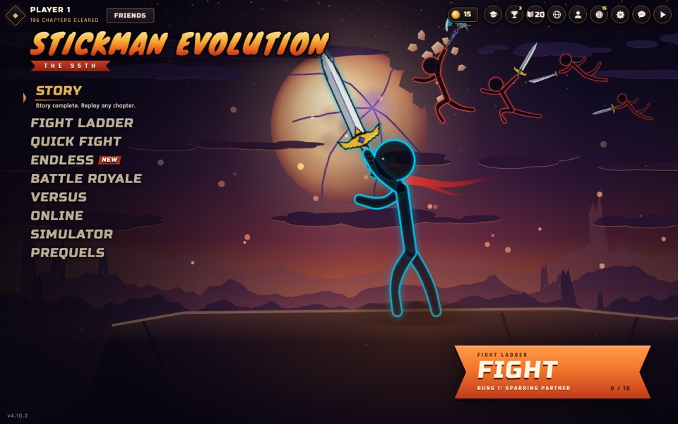 Home | 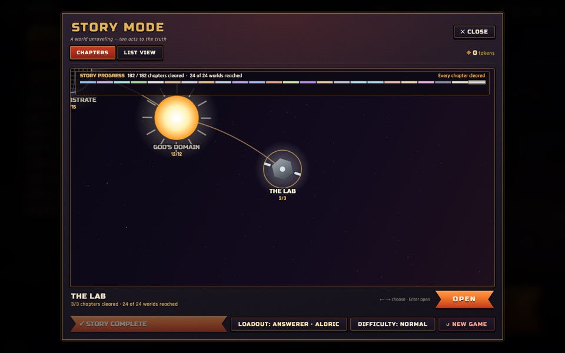 Story menu |
| 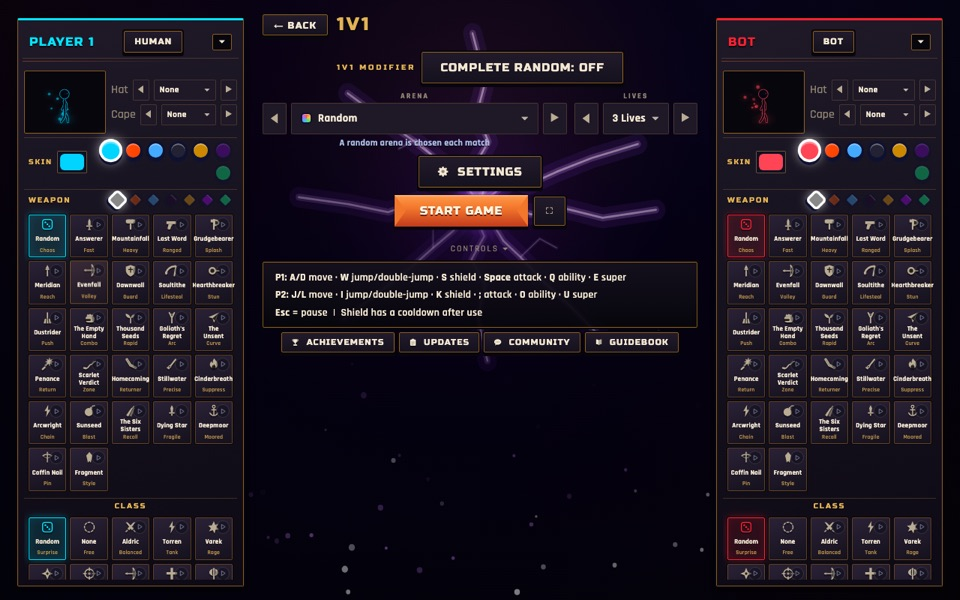 Mode setup | 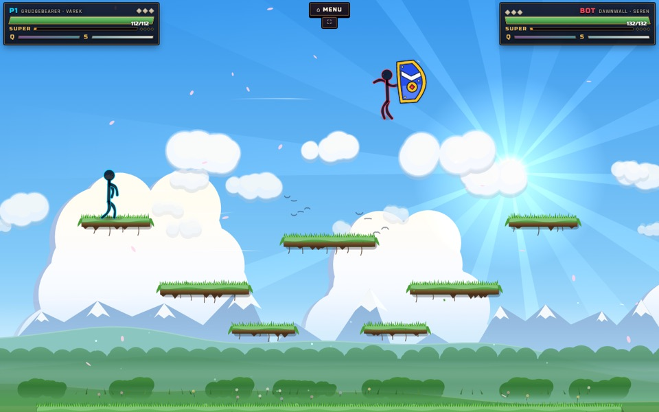 Fight HUD |
| 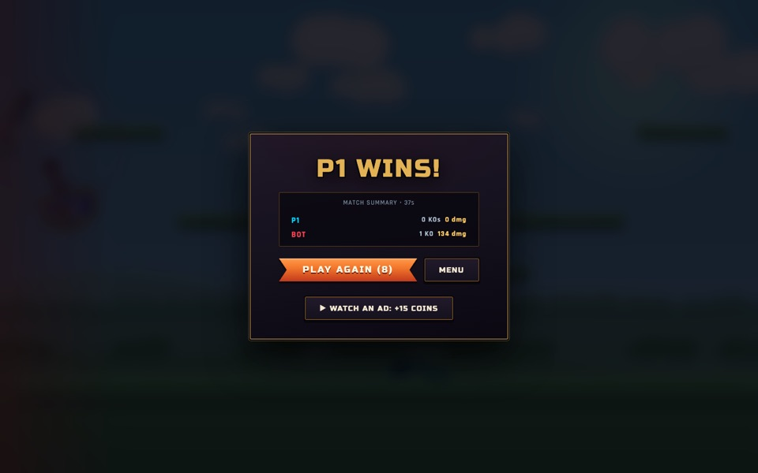 Match result | 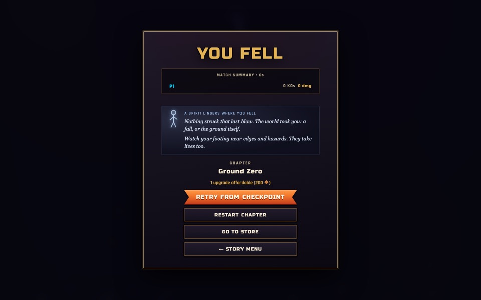 Story defeat |
| 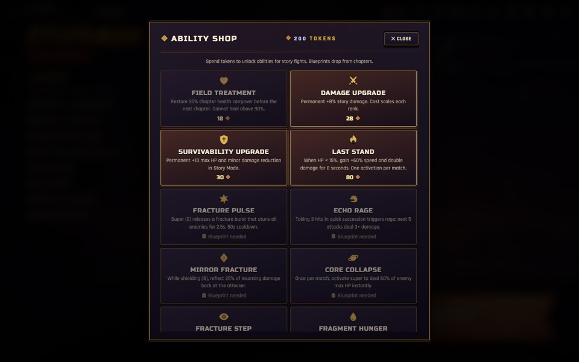 Ability shop | 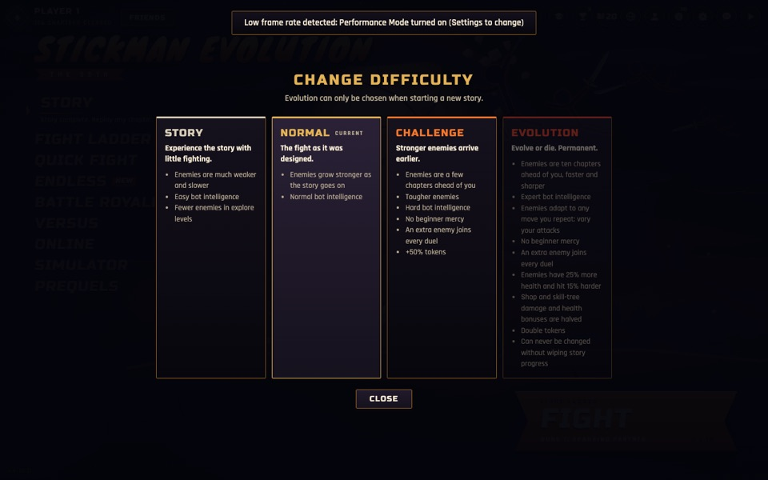 Difficulty picker, shared toast |
| 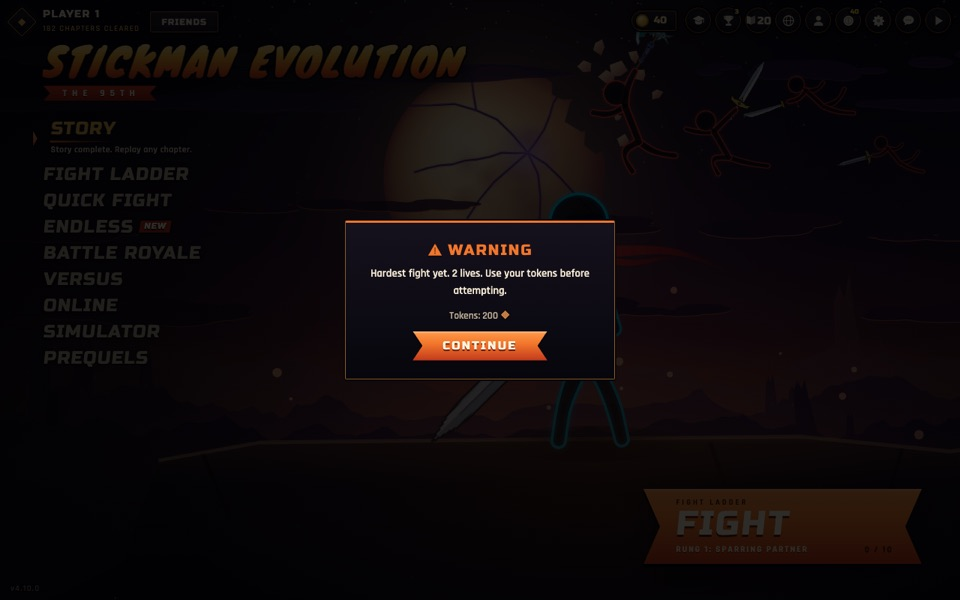 Warning dialog | 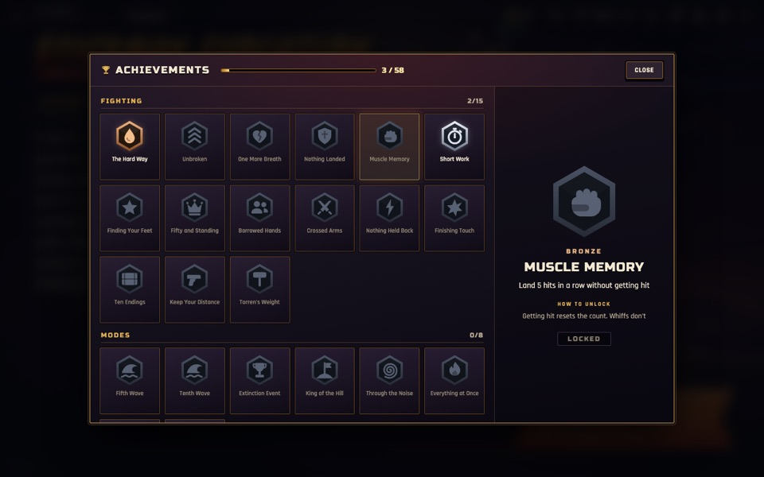 Achievements |
| 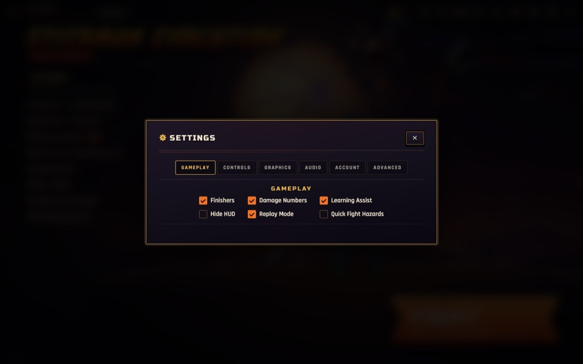 Settings | |

---

## 8. The audit

`npm run style` (`tools/audit/style.js`) checks js/ and SMB.css for:

| Rule | Catches |
|---|---|
| `literal-font` | A font family written by hand instead of a token or `FONT_*` constant |
| `emoji` | Stock emoji in UI strings (text marks are allowed) |
| `off-palette-hex` | UI colours outside the palette table (world-drawing files are exempt) |
| `round-corners` | `border-radius` / `roundRect` above 2px on plates and buttons (circles are fine) |
| `gradient-text` | Gradient-filled text outside the brush marks |
| `ui-glow` | `shadowBlur` glows in UI drawing code |

The baseline (`tools/audit/style-baseline.json`) records the debt that existed when the guide was written. A count going **up** fails the run and prints the lines. When you pay debt down, run `npm run style -- --update` to lock it in. Never update the baseline to hide new drift. `npm run style -- --list <rule>` prints every match.

Developer-only screens (admin, debug, cheats) are exempt. `npm run check` runs it too.

---

## 9. Known deviations

Shipped screens that break a rule above. They are listed so nobody copies them. Each line is removed when its fix ships.

- None listed as of Nov 23 2026. Remaining debt is tracked by `npm run style` (emoji, off-palette hex, round corners).

---

## Changing this guide

1. Every visual change names the rule here it follows.
2. If it needs a rule that isn't here, or breaks one, propose an amendment: what changes, why, before/after screenshots. The owner approves taste calls; sessions don't.
3. On approval, edit this file in the same commit as the change, and **delete** whatever the amendment replaces. There is one current answer, not a history. (History belongs in git and memory.)

### Decision log
| Date | Decision |
|---|---|
| 2026-11-21 | Type system: Russo One upright heads, Rajdhani body, brush for logo/Victory/ladder only, Georgia narration |
| 2026-11-21 | HUD: ink plates for tutorial, toasts and kill feed; no announcer glow; 1v1 hides overhead plates |
| 2026-11-21 | Fire gradient for brush marks only; headings flat gold; slate panels retired to the ink plate |
| 2026-11-22 | Naming: 30 achievements renamed by canon; coins and tokens stay separate with distinct marks; EXP everywhere; 182 chapters |
| 2026-11-22 | Icons from `smb-icons.js`; one banner button per screen |
| 2026-11-22 | Hit effects in three tiers (normal cut, heavy burst, crit disc); accent colour, never full-screen white |
| 2026-11-22 | Arenas: objects lit from the upper left, sky discs are backdrop; ledges separate by value; fight band stays calm; Volcano is a violet night eruption, Lava the orange lake (pending owner verdict) |
| 2026-11-22 | Motion is CSS entrances on one curve; no menu wipes. UI press/hover sounds everywhere; positional pan; arena ambience (pending owner verdict) |
